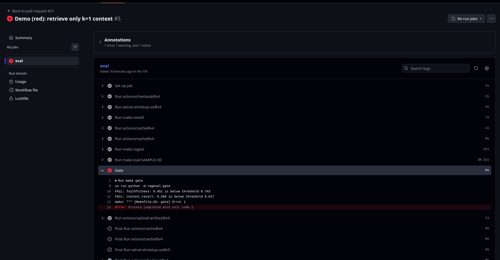
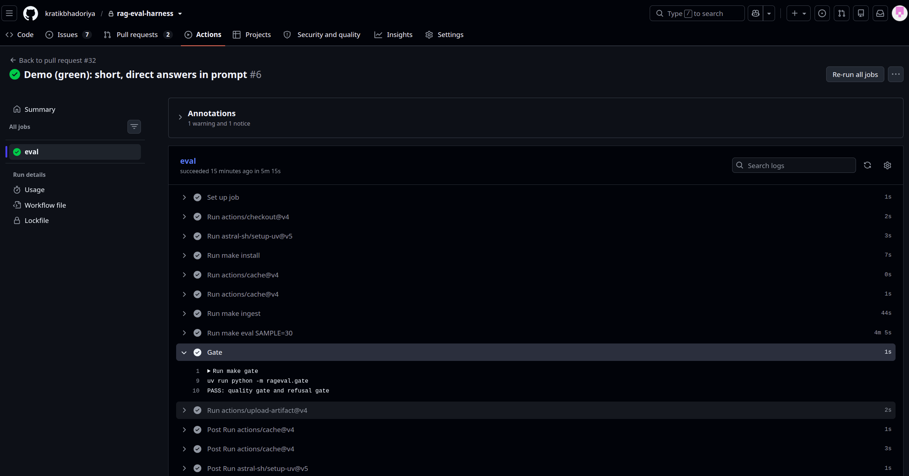

# RAG Eval Harness

A small harness that ingests PDFs, retrieves passages for a query, and measures retrieval and answer quality against a golden set.

## Golden set

`golden/golden.jsonl` holds 30 hand-written question/answer pairs, written from the PDFs and not generated by an LLM. Each row cites its source file(s) and page(s); unanswerable rows say the corpus does not contain the answer.

| type | count |
| --- | --- |
| factual | 13 |
| multi_hop | 7 |
| comparative | 5 |
| unanswerable | 5 |
| **total** | **30** |

The default Retriever is bm25: it won the three-way comparison on Context recall (0.927) by a margin of 0.053 over the runner-up hybrid (0.873) and 0.073 over dense (0.853).

A local cross-encoder Reranker (bm25 top-20 to top-5, `make eval RERANK=1`) was measured and not adopted: against bm25 k=10 it lowered Context recall from 0.907 to 0.827 (-0.080) and raised Faithfulness from 0.913 to 0.950, at a cost of about 1.7 s p50 / 1.9 s p95 added per query on a laptop CPU (see `metrics.md`).

## Frozen corpus

The 8 PDFs in `data/corpus/` are committed and checksummed in `data/corpus/SHA256SUMS`. `tests/test_golden.py` fails if any PDF changes, is added or is removed. Never edit the corpus: if it moves, no numbers compare.

## RAGAS version

The Judge metrics (Faithfulness, Context recall) use **RAGAS 0.4.3**, pinned exactly in `pyproject.toml` because metric classes have been renamed across releases. `langchain-community` is held below 0.4 because RAGAS 0.4.3 imports a module that 0.4 removed.

## CI quality gate

Every pull request runs `make eval SAMPLE=30` and `make gate` (`.github/workflows/eval.yml`). Thresholds live in `eval_thresholds.json` (baseline minus 0.05); the current baseline is in `results.md`.

| Demo | PR | Result |
| --- | --- | --- |
| Red: default `k` set to 1 | [#31](https://github.com/kratikbhadoriya/rag-eval-harness/pull/31) (closed) | Fails: faithfulness 0.451 < 0.743, context recall 0.260 < 0.617 |
| Green: prompt-file tweak only | [#32](https://github.com/kratikbhadoriya/rag-eval-harness/pull/32) (closed, not merged) | Passes the Quality gate and the Refusal gate |

Red PR: the Gate step fails and says which metric and threshold failed.

Green PR: the same check passes both gates.

